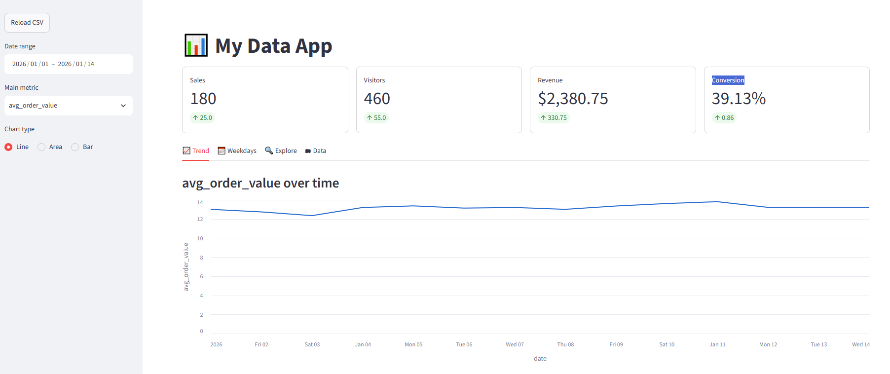
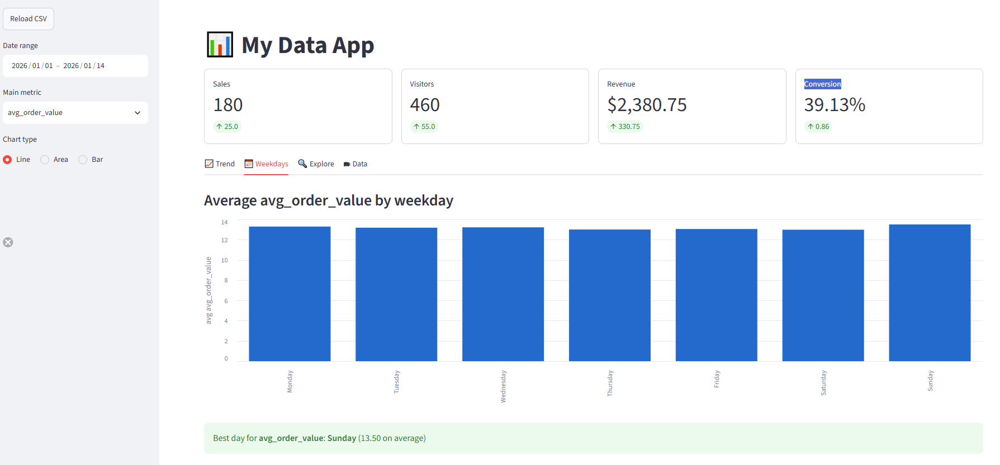
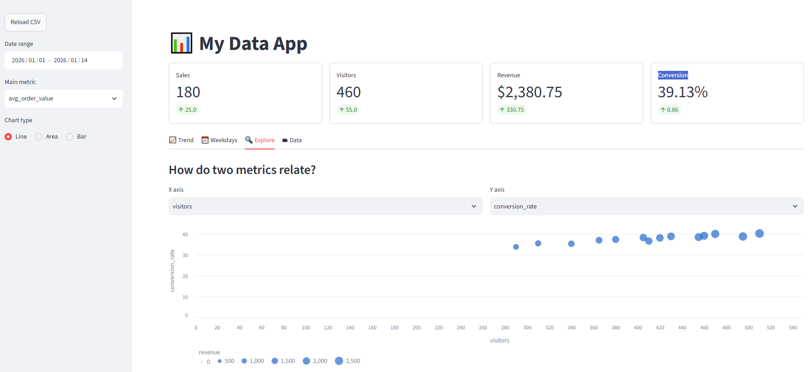
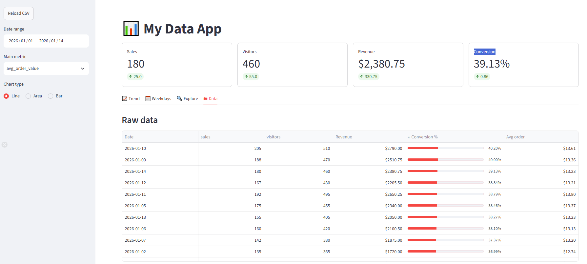

Streamlit is an open-source Python framework that turns a plain Python script into an interactive web app, with no HTML, CSS or JavaScript required. It is aimed at data work: dashboards, internal tools and quick prototypes around pandas DataFrames and charts.

The finished app built in this post, with sidebar filters, KPI cards and a trend chart:

## What is Streamlit?

A Streamlit app is a regular `.py` file. You call functions such as `st.title`, `st.selectbox` or `st.line_chart`, and Streamlit renders them as page elements in the browser.

The key idea is the **rerun model**: every time a user changes a widget, Streamlit runs the whole script again from top to bottom with the new widget values and updates only what changed on the page. There are no callbacks to wire up. A widget simply returns its current value.

`streamlit run` starts a Python server, the browser talks to it over a websocket, and all filtering and calculations happen live in Python. Changing the layout means editing the code (as in any web framework), but Streamlit picks up saved changes instantly, without a build step. The data itself is fully dynamic: swap the CSV for a database query and the app shows fresh numbers on every run.

The examples below use Streamlit 1.63.0 with pandas 3.0.

## Input data

The app reads a small `data.csv` with two weeks of daily figures:

| date | sales | visitors | revenue |
|---|---|---|---|
| 2026-01-01 | 120 | 340 | 1560.50 |
| 2026-01-02 | 135 | 365 | 1720.00 |
| 2026-01-03 | 98 | 290 | 1210.75 |
| 2026-01-04 | 150 | 410 | 1980.25 |
| 2026-01-05 | 175 | 455 | 2340.00 |
| 2026-01-06 | 160 | 420 | 2100.50 |
| 2026-01-07 | 142 | 380 | 1875.00 |
| 2026-01-08 | 110 | 310 | 1430.00 |
| 2026-01-09 | 188 | 470 | 2510.75 |
| 2026-01-10 | 205 | 510 | 2790.00 |
| 2026-01-11 | 192 | 495 | 2650.25 |
| 2026-01-12 | 167 | 430 | 2205.50 |
| 2026-01-13 | 155 | 405 | 2050.00 |
| 2026-01-14 | 180 | 460 | 2380.75 |

On load the app adds two derived columns: `conversion_rate` (sales / visitors × 100) and `avg_order_value` (revenue / sales).

## Setup

1. **Install the libraries** - create and activate a virtual environment, then run `pip install streamlit pandas`. Altair, used for one custom chart, is installed with Streamlit.
2. **Run the app** - from the folder containing `app.py` and `data.csv`, run `streamlit run app.py`. The app opens at `http://localhost:8501`.

Run it from the project folder, not from inside `venv`, because the CSV is loaded by a relative path.

## The code


import altair as alt
import pandas as pd
import streamlit as st

# --- Page setup -------------------------------------------------------------
st.set_page_config(page_title="My Data App", page_icon="📊", layout="wide")
st.title("📊 My Data App")

WEEKDAYS = ["Monday", "Tuesday", "Wednesday", "Thursday", "Friday", "Saturday", "Sunday"]
METRICS = ["sales", "visitors", "revenue", "conversion_rate", "avg_order_value"]

# --- Data loading -----------------------------------------------------------
@st.cache_data
def load_data(source) -> pd.DataFrame:
    df = pd.read_csv(source, parse_dates=["date"])
    # Derived columns: computed once and cached together with the raw data
    df["conversion_rate"] = (df["sales"] / df["visitors"] * 100).round(2)
    df["avg_order_value"] = (df["revenue"] / df["sales"]).round(2)
    return df.sort_values("date")

# --- Sidebar: all user inputs live here -------------------------------------
with st.sidebar:
    if st.button("Reload CSV"):
        st.cache_data.clear()

df = load_data("data.csv")

with st.sidebar:
    min_date, max_date = df["date"].min(), df["date"].max()
    date_range = st.date_input(
        "Date range", value=(min_date, max_date), min_value=min_date, max_value=max_date
    )
    metric = st.selectbox("Main metric", METRICS, index=2)
    chart_type = st.radio("Chart type", ["Line", "Area", "Bar"], horizontal=True)

# Wait until the user has picked both ends of the range
if len(date_range) != 2:
    st.info("Pick an end date to continue.")
    st.stop()

start_date, end_date = date_range
df = df[(df["date"] >= pd.Timestamp(start_date)) & (df["date"] <= pd.Timestamp(end_date))]

if df.empty:
    st.warning("No data in the selected range.")
    st.stop()

# --- KPI row ----------------------------------------------------------------
latest = df.iloc[-1]
previous = df.iloc[-2] if len(df) > 1 else latest

kpis = [
    ("Sales", "sales", "{:.0f}"),
    ("Visitors", "visitors", "{:.0f}"),
    ("Revenue", "revenue", "${:,.2f}"),
    ("Conversion", "conversion_rate", "{:.2f}%"),
]
for col, (label, field, fmt) in zip(st.columns(len(kpis)), kpis):
    col.metric(
        label,
        fmt.format(latest[field]),
        delta=round(float(latest[field] - previous[field]), 2),
        border=True,
    )

# --- Tabs -------------------------------------------------------------------
trend_tab, weekday_tab, explore_tab, data_tab = st.tabs(
    ["📈 Trend", "📅 Weekdays", "🔍 Explore", "🗂 Data"]
)

with trend_tab:
    st.subheader(f"{metric} over time")
    trend = df[["date", metric]].copy()

    if chart_type == "Line":
        st.line_chart(trend, x="date", y=metric)
    elif chart_type == "Area":
        st.area_chart(trend, x="date", y=metric)
    else:
        st.bar_chart(trend, x="date", y=metric)

    left, right = st.columns(2)
    left.caption("Totals for the selected range")
    left.dataframe(df[["sales", "visitors", "revenue"]].sum().rename("total"))
    right.caption("Daily averages")
    right.dataframe(df[METRICS].mean().round(2).rename("average"))

with weekday_tab:
    st.subheader(f"Average {metric} by weekday")
    by_day = (
        df.assign(weekday=df["date"].dt.day_name())
        .groupby("weekday")[metric]
        .mean()
        .reindex(WEEKDAYS)
        .dropna()
    )
    # Altair gives full control: fixed weekday order and tooltips
    weekday_chart = (
        alt.Chart(by_day.reset_index())
        .mark_bar()
        .encode(
            x=alt.X("weekday:N", sort=WEEKDAYS, title=None),
            y=alt.Y(f"{metric}:Q", title=f"avg {metric}"),
            tooltip=["weekday", alt.Tooltip(f"{metric}:Q", format=".2f")],
        )
    )
    st.altair_chart(weekday_chart, width="stretch")
    st.success(f"Best day for **{metric}**: **{by_day.idxmax()}** ({by_day.max():.2f} on average)")

with explore_tab:
    st.subheader("How do two metrics relate?")
    c1, c2 = st.columns(2)
    x_axis = c1.selectbox("X axis", METRICS, index=1)
    y_axis = c2.selectbox("Y axis", METRICS, index=0)

    st.scatter_chart(df, x=x_axis, y=y_axis, size="revenue")
    st.write(f"Correlation between **{x_axis}** and **{y_axis}**: `{df[x_axis].corr(df[y_axis]):.2f}`")

    with st.expander("Compare several metrics at once"):
        picked = st.multiselect("Metrics", METRICS, default=["sales", "visitors"])
        if picked:
            st.line_chart(df, x="date", y=picked)

with data_tab:
    st.subheader("Raw data")
    st.dataframe(
        df,
        hide_index=True,
        width="stretch",
        column_config={
            "date": st.column_config.DateColumn("Date", format="YYYY-MM-DD"),
            "revenue": st.column_config.NumberColumn("Revenue", format="$%.2f"),
            "avg_order_value": st.column_config.NumberColumn("Avg order", format="$%.2f"),
            "conversion_rate": st.column_config.ProgressColumn(
                "Conversion %", min_value=0, max_value=100, format="%.2f%%"
            ),
        },
    )

    st.download_button(
        "⬇️ Download filtered CSV",
        df.to_csv(index=False).encode("utf-8"),
        file_name=f"data_{start_date}_{end_date}.csv",
        mime="text/csv",
    )

    with st.expander("Summary statistics"):
        st.dataframe(df[METRICS].describe().round(2))


## How it works

- **Caching** - `@st.cache_data` stores the loaded DataFrame, so the CSV is read once rather than on every rerun. The *Reload CSV* button clears the cache to pick up edits to the file.
- **Sidebar** - anything inside `with st.sidebar:` is rendered in the left panel, keeping filters apart from the results.
- **Early exit** - `st.stop()` halts the script while the user has picked only one end of the date range, or when the filter returns no rows.
- **KPI cards** - `st.metric` shows the latest value and the change from the previous day, coloured green or red automatically.
- **Layout** - `st.columns` places elements side by side, `st.tabs` splits the page into views and `st.expander` hides secondary content.
- **Built-in charts** - `st.line_chart`, `st.area_chart`, `st.bar_chart` and `st.scatter_chart` take a DataFrame and column names directly.
- **Custom charts** - `st.altair_chart` renders any Altair chart; here it keeps weekdays in calendar order and adds tooltips.
- **Table formatting** - `column_config` formats columns as dates and currency, and draws the conversion rate as a progress bar.
- **Download** - `st.download_button` exports the currently filtered data as a CSV.

## Screenshots

Average order value by weekday, rendered with Altair, with Sunday highlighted as the best day:

Scatter chart of visitors against conversion rate, with point size driven by revenue:

Raw data formatted with `column_config`, sorted by conversion rate (click a column header to sort):

## Deploying

A Streamlit app needs a running Python server, so it can be hosted on Streamlit Community Cloud (free for public apps), in a Docker container on any cloud, or directly inside Snowflake.

### Streamlit in Snowflake

Snowflake acquired Streamlit and runs Streamlit apps natively next to the data, using Snowflake roles for access control and Snowflake compute to run the app. Instead of reading a CSV, the app queries Snowflake tables directly, so the data never leaves the platform. Apps can be created in the Snowsight UI, with SQL or with the Snowflake CLI:

- [Getting started with Streamlit in Snowflake](https://docs.snowflake.com/en/developer-guide/streamlit/getting-started) - deploy a first app in a few minutes
- [Create your Streamlit app](https://docs.snowflake.com/en/developer-guide/streamlit/create-streamlit-sql) - Snowsight, SQL and Snowflake CLI options, plus CI/CD with GitHub Actions

## Limitations

- **Full reruns** - every widget change reruns the whole script, so slow data loading or heavy calculations need `@st.cache_data` or `st.cache_resource` to keep the app responsive.
- **Limited layout control** - columns, tabs and the sidebar cover most dashboards, but pixel-precise layouts are hard to achieve.
- **Best for internal tools** - Streamlit fits data apps, prototypes and team dashboards. Complex customer-facing apps with many users, authentication flows or fine-grained state are better served by a full web framework.

## References

- [Streamlit official website](https://streamlit.io/)
- [Streamlit documentation](https://docs.streamlit.io/)
- [Streamlit API reference](https://docs.streamlit.io/develop/api-reference)
- [Getting started with Streamlit in Snowflake](https://docs.snowflake.com/en/developer-guide/streamlit/getting-started)
- [Vega-Altair documentation](https://altair-viz.github.io/)
